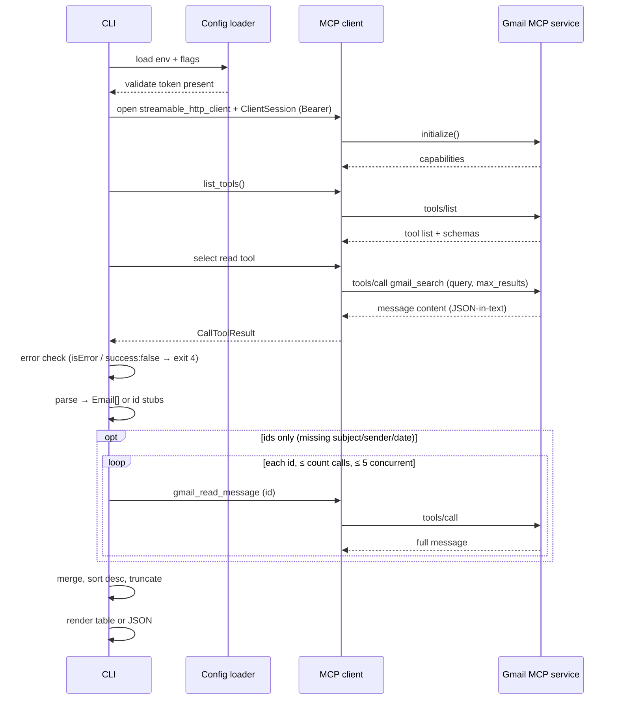

# Recent-Mail Fetcher — Design

## Architecture

A single async Python process structured into small, importable components so the same core runs both as a standalone CLI and inside a Databricks notebook.

Components and responsibilities:

- **CLI entry (`__main__.py`)** — argparse; parses flags, validates required config, sets exit codes, dispatches to the core.
- **Config loader** — merges environment variables with CLI flags (flags win); validates `DATABRICKS_TOKEN` is non-empty; supplies defaults for URL, count, label, timeouts.
- **MCP client wrapper** — builds an authenticated HTTP client and opens a Streamable HTTP MCP session; isolates transport so the token source and HTTP library are swappable for the notebook variant.
- **Tool discovery** — calls `session.list_tools()`; filters out write/send/delete tools; selects the read tool by explicit `--tool` or a ranked heuristic: exact `gmail_search` first, then other message-level search/list tools, then thread-level tools last. Also resolves the read-message tool (`gmail_read_message`, else a name matching `read_message`/`get_message`) for hydration.
- **Arg builder (`args.py`)** — builds call arguments from `inputSchema`: count via alias list (`max_results`, `limit`, `count`, `page_size`, `maxResults`, `top`), label via a label/folder property if declared, otherwise a Gmail `query` string (`label:<LABEL>`, `in:inbox` for INBOX) when `query` is declared. Checks `required` properties and fails with exit 4 naming any it cannot fill.
- **Invoker** — calls `session.call_tool(name, args)`; detects tool-reported errors (`isError` or parsed `success: false`) and maps them to exit 4 with the message on stderr.
- **Parser** — normalizes the tool result content (JSON-in-text or structured blocks) into a list of `Email`, or into id-only stubs when the result carries only ids; sort/truncate to the requested count.
- **Hydrator (`hydrate.py`)** — when stubs lack subject/sender/`received_at`, calls the read-message tool once per id (≤ count calls, ≤ 5 concurrent) and merges the fields.
- **Renderer** — table (default) or JSON (`--json`); writes to stdout only by default.

```
CLI entry ──▶ Config loader
              │
              ▼
        MCP client wrapper (Bearer auth + Streamable HTTP)
              │
              ▼
        Tool discovery ──▶ Arg builder ──▶ Invoker (call_tool, error check)
                                              │
                                              ▼
                                        Parser ──▶ Hydrator (only if ids-only)
                                                        │
                                                        ▼
                                                  Renderer (table / json)
```

## Data Flow



The connection is short-lived: connect → initialize → discover → search → (hydrate) → parse → render → close. No persistent session or polling.

### Search then hydrate

1. Build args: `query` from the label (`label:<LABEL>`; INBOX → `in:inbox`), `max_results` from `--count`. If a required property cannot be filled, exit 4 before calling.
2. Call the search tool once. Single page only; if the result has a `cursor` and fewer than `--count` messages came back, warn that more exist (multi-page retrieval is out of scope).
3. Check for a tool-reported error. On `isError` or `success: false`, print the message (and `validFields` if present) to stderr, print nothing to stdout, exit 4.
4. Parse. If every message has subject, sender and `received_at`, skip hydration.
5. Otherwise call the read-message tool per id (id parameter name taken from its schema; see Open questions), bounded by `asyncio.Semaphore(5)` and at most `--count` calls. A failed read keeps the id-only entry and logs a warning.
6. Sort, truncate, render.

The design is discovery-driven: it handles both "full email objects" and "ids only, needs read" results, because the real shape is unconfirmed.

## Interfaces

### CLI

```
recent-mail-fetcher [--list-tools] [--json] [--count N] [--label NAME]
                    [--tool NAME] [--url URL] [--allow-write-tools]
                    [--read-timeout SECONDS] [-v | --verbose]
```

Flags override environment variables. `--token` is intentionally omitted from the CLI surface to keep secrets out of shell history; the token comes from `DATABRICKS_TOKEN` only.

### Environment variables

| Variable | Required | Purpose |
|----------|----------|---------|
| `DATABRICKS_TOKEN` | yes | Bearer token for the AI Gateway. |
| `GMAIL_MCP_URL` | no | Override endpoint; defaults to the service URL above. |
| `GMAIL_MCP_LABEL` | no | Label/box to read; default `INBOX`. |
| `GMAIL_MCP_COUNT` | no | Max results; default `10`. |
| `GMAIL_MCP_TOOL` | no | Force a specific tool name (skip heuristic). |
| `HTTP_TIMEOUT_READ` | no | Read timeout seconds; default `60`. |

### MCP tool invocation contract

- Discovery: `tools/list` → `Tool(name, description, inputSchema)`.
- Invocation: `tools/call` with arguments built from `inputSchema`. Count and label are injected only when the schema declares a matching property; unknown schema fields are never added. Exception rule for label: when the schema declares `query` and no label/folder property, the label is encoded into `query`.
- Query-building rule: `label:<LABEL>` for any label; `INBOX` (default) → `in:inbox`. The label value is passed as a single token; whitespace in a label is quoted (`label:"My Label"`).
- Count aliases, in priority order: `max_results`, `limit`, `count`, `page_size`, `maxResults`, `top`.
- Required check: every name in `inputSchema.required` must be filled; otherwise exit 4 with a message naming the property, no call made.
- Result: a `CallToolResult` whose `content` is a list of blocks (typically `TextContent` holding JSON). Before parsing, the invoker treats `isError: true` or a JSON object with `success: false` as a tool failure (exit 4). The parser inspects each block's type and parses text blocks as JSON, falling back to raw text.

### Observed tool names (live `system.ai.gmail`)

- Read: `gmail_search` (preferred), `gmail_read_message`, `gmail_search_threads`, `gmail_get_thread`, `gmail_list_drafts`, `gmail_list_labels`, `gmail_get_attachment`.
- Write (blocked by default): `gmail_send_email`, `gmail_create_draft`, `gmail_update_draft`, `gmail_forward_email`, `gmail_create_label`, `gmail_label_message`, `gmail_unlabel_message`, `gmail_label_thread`, `gmail_unlabel_thread`, and `*_with_attachments` variants.
- `gmail_search_threads` schema: `query` (required), `max_results`, `cursor`. It rejected a call without `query` with `{"errorType": "invalidArguments", "missing": ["query"], "success": false, "validFields": [...]}`.
- Note: the write-pattern block list must also cover `label`/`unlabel` verbs (`gmail_label_*`, `gmail_unlabel_*`), which the current pattern does not match.

### JSON output envelope

```json
{
  "service": "system.ai.gmail",
  "fetched_at": "2025-01-20T13:40:00Z",
  "tool": "list_messages",
  "count": 10,
  "emails": [ { "id": "...", "subject": "...", "sender": "...", "received_at": "...", "snippet": "...", "label_ids": ["INBOX","UNREAD"], "is_unread": true } ]
}
```

### Exit codes

| Code | Meaning |
|------|---------|
| 0 | Success (including empty result). |
| 2 | Auth failure (missing/invalid token, 401/403, permission denied). |
| 3 | No matching read tool found. |
| 4 | Tool call failed (rejected args, retries exhausted). |
| 5 | Result not parseable (with raw-text fallback already attempted). |

## Data Models

```python
@dataclass
class Email:
    id: str                      # message id from the service
    thread_id: str | None
    sender: str | None           # "From" / author
    recipients: list[str]        # "To"/"Cc"; may be empty
    subject: str | None
    received_at: datetime | None # parsed ISO-8601 or RFC-2822
    snippet: str | None          # short preview (~200 chars)
    label_ids: list[str]
    is_unread: bool
    has_attachments: bool | None
```

All fields are best-effort from the tool result; missing values become `None` or empty. Sort key: `received_at` descending, then `id` ascending for a stable tiebreak.

## Error Handling

| Condition | Handling | Exit |
|-----------|----------|------|
| Missing/empty token | Fail fast with a clear message; no network call. | 2 |
| 401 / 403 | Report auth failure; do not retry. | 2 |
| 429 / 5xx / connection reset / read timeout | Retry with exponential backoff, ≤3 attempts. | 4 if exhausted |
| No read tool found | Log available tools + schemas for diagnosis. | 3 |
| Selected tool rejects args | Log schema + tried args; retry once without the count arg. | 4 if still failing |
| Required schema property cannot be filled | Message names the property; no call made. | 4 |
| Tool result `isError` or `success: false` | Message (and `validFields`) to stderr; nothing on stdout. Not retried unless it is the rejected-args case above. | 4 |
| Hydration read fails for one id | Warn, keep id-only entry, continue. | 0 |
| Read-message tool missing but needed | Print id-only entries; warn. | 0 |
| HTTP 403 with a PAT limited to `ai-gateway:read` | Auth failure message; hint that MCP uses POST and needs a broader scope. | 2 |
| Token valid but service permission denied | Surface the gateway error; do not retry. | 2 |
| Result not parseable as JSON | Fall back to raw text per block; warn. | 5 |
| Empty result | Print "no messages". | 0 |
| Fewer than count messages | Print all available; no error. | 0 |

A redacting logger masks the token (`Bearer ***`) so no secret reaches logs. HTTP timeouts default to 30 s connect / 60 s read (read configurable).

## Non-functional considerations

- **Security:** read-only by construction — write/send/delete tools are blocked unless `--allow-write-tools` is passed (and this app never invokes them). Token is env-only, redacted in logs, never persisted, never passed on the CLI. HTTPS only.
- **Least privilege at the source:** the Databricks token grants whatever the underlying principal can do through the gateway; restrict the gateway/service scopes on the Databricks side rather than relying on this app.
- **Determinism:** output is sorted newest-first with a stable tiebreak; re-running yields consistent ordering.
- **Performance / cost:** single short-lived connection; no polling or background sync; the AI Gateway may apply rate limits and guardrails (429 handled with backoff).
- **Portability:** runs on Python 3.10+. The standalone path uses standard `httpx`; the notebook variant uses `httpx2` + `nest_asyncio` and pulls the token from `dbutils`, but reuses the same discover→call→parse→render core.
- **Observability:** structured logs to stderr; a `--verbose` mode increases detail; stdout is reserved for results so JSON stays clean for piping.
- **Privacy:** no message bodies or PII are written to logs beyond what the chosen renderer emits to stdout.

## Open questions

1. Exact result shape of `gmail_search` (full objects vs. ids only; snippet; `cursor` key name).
2. Exact result shape of `gmail_read_message` and its id parameter name (`message_id` vs. `id`); the hydrator reads the name from the tool's schema.
3. Whether `gmail_search` declares `query` as required and its page size limit.
4. Minimal PAT scope that permits MCP POST calls.

## Technology stack

- **Language:** Python 3.10+.
- **MCP SDK:** `mcp` (Python) — `mcp.client.streamable_http.streamable_http_client` and `mcp.ClientSession`.
- **HTTP client:** `httpx` (standalone); `httpx2` only inside Databricks Runtime.
- **Config:** `argparse` + `os.environ`; optional `python-dotenv` for local `.env` loading.
- **Notebook glue (notebook variant only):** `nest_asyncio`; token via `dbutils.notebook.entry_point.getDbutils().notebook().getContext().apiToken().get()`.
- **No** web framework, DB, or scheduler — intentionally minimal.

## Unit Testing Strategy

- **Parser** is the highest-value unit: feed canned `CallToolResult` payloads (valid JSON, nested JSON, malformed JSON, empty, mixed block types) and assert the normalized `Email[]` and exit codes.
- **Tool discovery / selection:** with a fake `ClientSession`, assert the heuristic picks read tools, rejects write tools, and exits 3 when nothing matches; assert `--tool` overrides the heuristic.
- **Config loader:** assert env-vs-flag precedence, the missing-token short-circuit (exit 2, no call), and default values.
- **Arg injection:** assert count/label are added only when `inputSchema` declares them and omitted otherwise.
- **Gmail search compatibility:** unit-test selection ranking (`gmail_search` over `gmail_search_threads`), query building (`in:inbox`, `label:X`), `max_results` mapping, required-param failure, `success:false`/`isError` → exit 4 with empty stdout, and hydration (ids-only, full objects, partial failure, ≤ count calls, ≤ 5 concurrency). The stub server serves `gmail_search` and `gmail_read_message`.
- **Renderer:** assert JSON envelope shape and that the table is sorted newest-first.
- **Transport layer:** keep thin and covered by a small integration smoke test against a stub MCP server (or a recorded fixture) so retries, timeouts, and the 401/403 non-retry path are exercised without the real gateway.
- **Exit codes:** one assertion per code path.

Notebook-vs-standalone differences (token source, HTTP client, `nest_asyncio`) are isolated behind an injectable interface so tests target the shared core and skip notebook-only glue.
